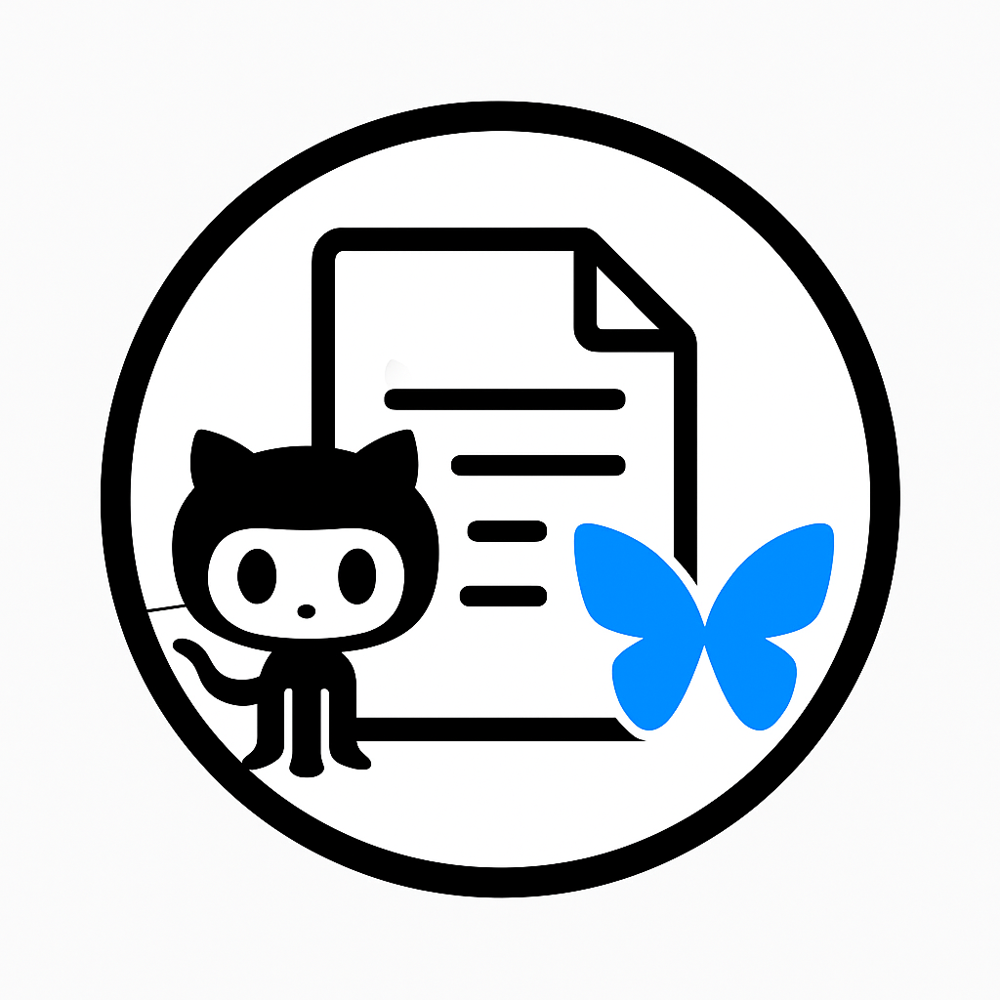

# Advertiser

Advertiser posts public repositories from `soodoku` and the organizations listed in
[`scripts/post_repo_to_bsky.py`](scripts/post_repo_to_bsky.py) to Bluesky. It uses
reviewed blurbs or GitHub descriptions, so posting does not require an OpenAI key.

## Selection

- Repositories need a description and at least one star in the scheduled
  workflow. The cutoff is set by `GITHUB_STAR_CUTOFF` and defaults to five for
  local runs. Private, archived, disabled, and forked repositories are excluded.
- Daily runs select the highest-starred available repository from the top 30,
  except Fridays, which use the rotation pool starting below the top 30.
  Manual runs can also choose the rotation pool.
  If the chosen pool is empty, the other pool is used.
- Five prominent repositories have reviewed descriptions in
  `data/featured_blurbs.json`. Other posts use their GitHub descriptions.
- Repositories posted in the last 90 days are excluded. The workflow commits
  successful posts to `data/post_history.json` and also checks recent posts on
  the Bluesky account before choosing, which protects against a retry after a
  history commit fails.

The repository workflow runs daily at 7:00 a.m. Pacific time.
GitHub may delay scheduled runs. If the repository has no activity for 60 days,
GitHub may disable its schedule; re-enable the workflow in the Actions tab.

## Setup and preview

Set repository Actions secrets `BSKY_HANDLE` and `BSKY_PASSWORD`. Use a Bluesky
app password for `BSKY_PASSWORD`. The workflow uses its built-in `GITHUB_TOKEN`
to read public GitHub repositories and save post history. Its `contents: write`
permission is limited to the posting job.

Use **Actions → Post GitHub Repo to Bluesky → Run workflow**. The default manual
run is a dry run: it fetches repositories and recent Bluesky posts, prints the
candidate and final text, and publishes nothing. Select `featured` or `rotation`
to preview a particular pool. Set `dry_run` to false for a live manual post.

To preview locally:

```sh
python3 -m venv .venv
.venv/bin/pip install -r requirements.txt
.venv/bin/python scripts/post_repo_to_bsky.py --dry-run --handle YOUR_HANDLE
```

The public GitHub API can be rate limited without a token. Set `GITHUB_TOKEN`
locally if needed. No Bluesky password is required for a dry run.

## Paper posts

The separate **Post Paper to Bluesky** workflow is scheduled daily at 7:00 a.m.
Pacific time. GitHub can delay scheduled runs; this is not a guaranteed posting
time. It posts from the same Bluesky account using the existing Actions
secrets. The reviewed queue is `data/papers.json`; the public paper catalog at
`https://gsood.com/research/catalog.json` supplies manuscript, replication,
and data links. The queue specifies a caption, 1–4 ordered figures, SHA-256
checksums of their source files, and alt text. The bot removes image metadata,
keeps original aspect ratios, checks the 2 MB limit, and links labels in the
caption with Bluesky facets. Images and link cards cannot share one post embed.

Reviewed posts take priority. When no unposted reviewed paper remains, the bot
selects the next unposted paper in catalog order and posts its title with
manuscript, replication, and data links where available. These posts have no
figures or generated summaries. The catalog is fetched on each run, so newly
added papers enter the feed automatically. Only entries marked `paper` qualify.

Papers are posted once. The workflow commits successful posts to
`data/paper_post_history.json` and checks recent Bluesky posts for a manuscript
link before publishing. If every catalog paper has been posted, the daily run
exits without posting.

The first queued paper is *Is Cynicism Taken as Evidence of Political
Sophistication?* Its three figures show group means, robustness estimates, and
the response distribution. The caption links to the paper PDF and replication
repository.

Use **Actions → Post Paper to Bluesky → Run workflow** to preview (the default)
or publish. A `paper_id` may select a specific catalog paper. Local preview:

```sh
.venv/bin/python scripts/post_paper_to_bsky.py --dry-run --handle YOUR_HANDLE
```

## Development checks

```sh
black --check scripts tests
isort --check-only scripts tests
flake8 scripts tests
python -m pytest -q
actionlint .github/workflows/post-to-bsky.yml
actionlint .github/workflows/post-paper-to-bsky.yml
```
